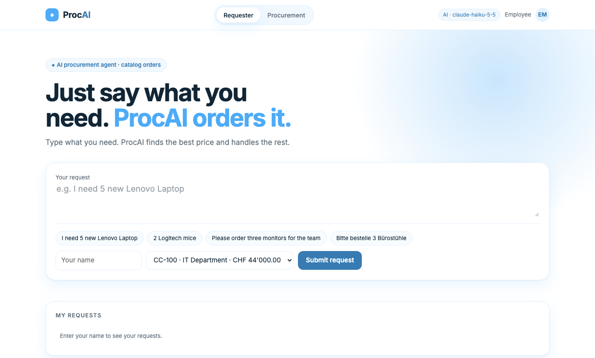
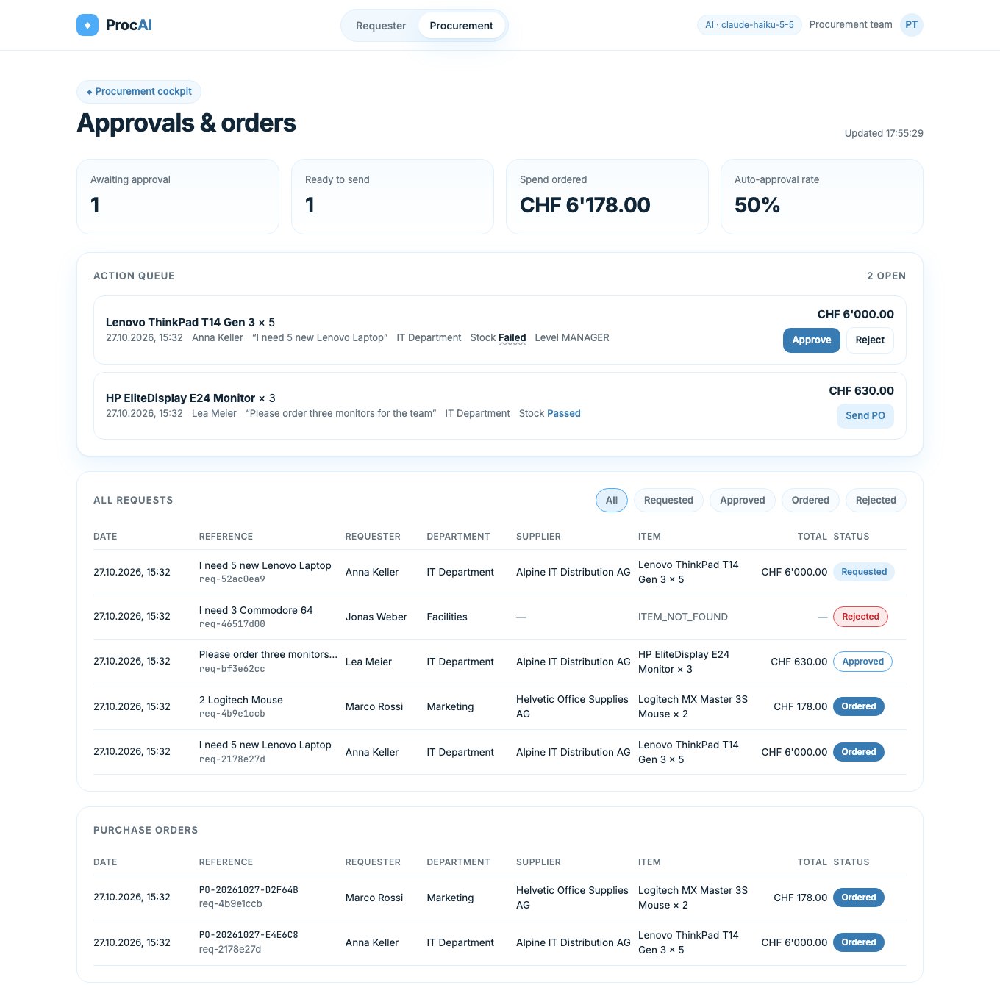
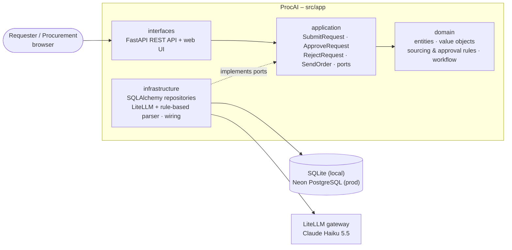
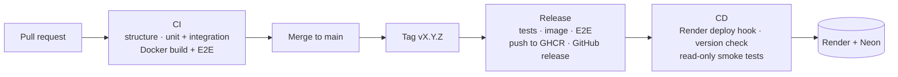

# ProcAI – AI procurement agent

[](https://github.com/zTK47/AI-Procurement-/actions/workflows/ci.yml)
[](https://github.com/zTK47/AI-Procurement-/releases)
[](https://github.com/zTK47/AI-Procurement-/actions/workflows/cd.yml)

**Just say what you need – ProcAI orders it.** Employees describe a purchase in
plain language (*"I need 5 new Lenovo Laptop"*, *"Bitte bestelle 3
Bürostühle"*). An LLM extracts the request, deterministic business rules pick
the best-priced catalog item, check budget and stock, route it for approval
and generate the purchase order for the supplier – no forms, no catalog search.

- **Live:** https://ai-procurement-dfjq.onrender.com (free tier: the first request after idle takes about a minute)
- **Latest release:** [Releases](https://github.com/zTK47/AI-Procurement-/releases) · image `ghcr.io/ztk47/procai`
- **Capstone** of *AI-assisted Software Development*, BSc Business Information Technology, FHNW, autumn 2026

## What it does

Catalog order (use case [UC-001](docs/specs/UC-001-CATALOG-ORDER.md)):

1. The **requester** writes a prompt and picks a cost center.
2. The **LLM** (Claude Haiku 5.5 via the LiteLLM gateway) returns quantity, product and category as JSON.
3. **Rules** resolve the catalog item – if several match, the cheapest wins – and check budget and stock.
4. **Approval:** ≤ CHF 1,000 and in stock → auto-approved; otherwise MANAGER (≤ CHF 25,000) or DIRECTOR.
5. **Procurement** approves or rejects (with reason) and sends the purchase order; the budget is consumed.

Workflow: `CREATED → PARSED → RESOLVED → VALIDATED → PENDING_APPROVAL → APPROVED → ORDER_SENT` (or `REJECTED`), every step stored as audit trail.

| Requester view | Procurement view |
|---|---|
|  |  |

## Architecture

Clean Architecture – dependencies point inward
(`domain ← application ← interfaces ← infrastructure`). The LLM only parses;
everything that decides money is deterministic and unit-tested
([ADR-001](docs/adr/ADR-001-catalog-order-mvp-architecture.md)).



Data model: 7 related tables (suppliers, catalog items, cost centers,
procurement requests, status history, purchase orders, order lines) –
[DATA-MODEL.md](docs/DATA-MODEL.md) with ER diagram.

| Layer | Technology |
|---|---|
| Web UI | HTML/CSS/JS served by FastAPI (light blue / white) |
| API | FastAPI, pydantic |
| Persistence | SQLAlchemy 2 – SQLite locally, Neon PostgreSQL in production |
| AI | LiteLLM gateway (OpenAI-compatible), Claude Haiku 5.5, rule-based fallback |
| Delivery | Docker, GitHub Actions, GitHub Packages (GHCR), Render |

## Run locally

Requires Python 3.12+.

```bash
bash scripts/setup-python.sh                  # .venv + dependencies
cp .env.example .env                          # add your LiteLLM key
.venv/bin/python scripts/init_db.py --reset   # procurement.db with demo data
.venv/bin/uvicorn app.main:create_app --factory --reload --app-dir src
```

Open http://localhost:8000 (API docs: http://localhost:8000/docs). Without a
key, set `PARSER=rules` to use the rule-based parser.

With Docker:

```bash
docker run --rm -p 8000:8000 --env-file .env ghcr.io/ztk47/procai:latest
```

## Tests

Test-driven: for UC-001 the agent session log shows a failing test run before the
implementation existed (modules missing, 13:56 UTC) and a passing run afterwards (14:01
UTC). The commits were recorded afterwards in `test:` then `feat:` order. Evidence and timing
note: [docs/PROMPTS.md](docs/PROMPTS.md).

| Level | What | Command |
|---|---|---|
| Unit (37) | value objects, rules, workflow, parsers, use cases | `.venv/bin/python -m pytest tests/unit` |
| Integration (20) | REST API + SQLite, repository round trips | `.venv/bin/python -m pytest tests/integration` |
| E2E (4) | full flow against a running instance / container | `E2E_BASE_URL=http://localhost:8000 .venv/bin/python -m pytest tests/e2e` |

## CI/CD and deployment



- [`ci.yml`](.github/workflows/ci.yml) – every push and pull request.
- [`release.yml`](.github/workflows/release.yml) – on tags `v*`; publishes `ghcr.io/ztk47/procai`.
- [`cd.yml`](.github/workflows/cd.yml) – only after a green release; production never gets untested code ([ADR-002](docs/adr/ADR-002-deployment-render-neon.md)).
- Secrets (`LITELLM_API_KEY`, `DATABASE_URL`, deploy hook) live only in Render and GitHub secrets – never in the repository.

## AI-assisted development

Built with **Claude Code** (Claude Opus 5.5), steered by the AI-SDLC router
[`AGENTS.md`](AGENTS.md) and phase skills in [`skills/`](skills/): specify →
design → develop (TDD) → validate → deploy, with every merge, release and
deployment approved by the team. MCP servers (Context7, GitMCP) give the agent
current library docs and repository context.

Model choice and AI cost (≈ USD 0.00005 per request) are documented in
[AI-TOOLING.md](docs/AI-TOOLING.md) and [MODEL-EVALUATION.md](docs/MODEL-EVALUATION.md).

## Documentation

| Document | Content |
|---|---|
| [docs/PROJECT.md](docs/PROJECT.md) | purpose, architecture, commands, configuration |
| [docs/specs/UC-001-CATALOG-ORDER.md](docs/specs/UC-001-CATALOG-ORDER.md) | use case, errors, acceptance criteria |
| [docs/adr/](docs/adr/) | ADR-001 architecture, ADR-002 deployment, ADR-003 sourcing and budget (proposed) |
| [docs/DATA-MODEL.md](docs/DATA-MODEL.md) | ER diagram, relationships, [schema.sql](docs/schema.sql) |
| [docs/AI-TOOLING.md](docs/AI-TOOLING.md) | coding agent, MCP, model selection, AI cost, lessons learned |
| [docs/PROMPTS.md](docs/PROMPTS.md) | prompt log, corrections, UC-001 → tests traceability |
| [docs/TASKS.md](docs/TASKS.md) | lifecycle state and evidence |

## Repository structure

```
src/app/            domain · application · interfaces (API + UI) · infrastructure · main.py
tests/              unit · integration · e2e
docs/               project docs, use cases, ADRs, data model, AI tooling
scripts/            setup, demo database, model benchmark
.github/workflows/  CI, release, CD
AGENTS.md, skills/  AI-SDLC router and phase skills for the coding agent
```

Built on the [AISL AI-SDLC template](https://docs.aisl.science/learning-and-resources/ai-sdlc).
