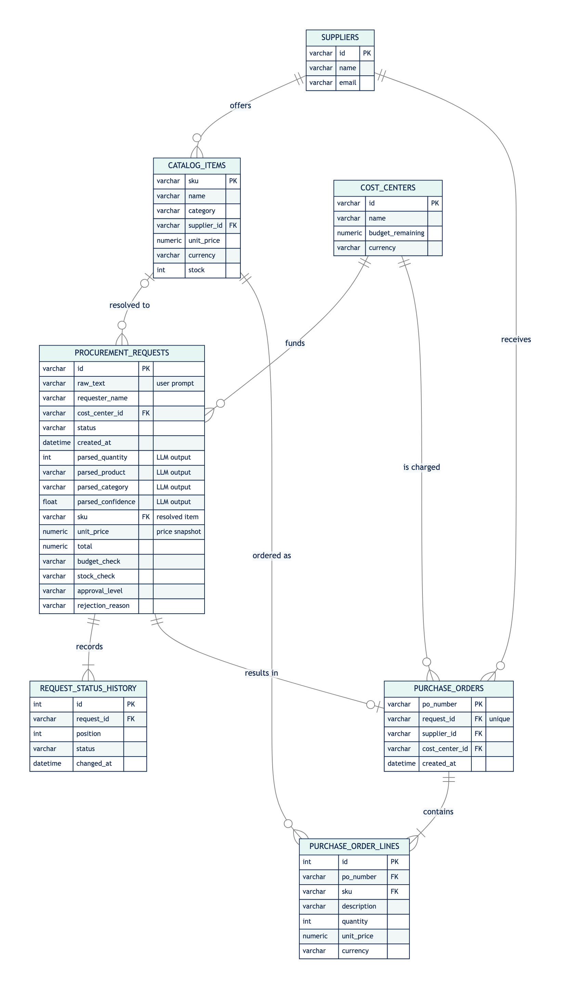
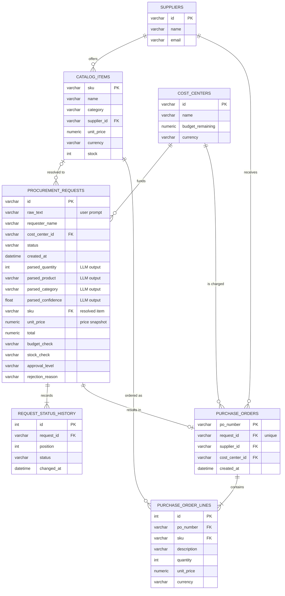

# Data model

SQLite database `procurement.db`, mapped with the SQLAlchemy ORM in
[`src/app/infrastructure/db.py`](../src/app/infrastructure/db.py).
DDL: [`schema.sql`](schema.sql). Recreate the database with demo data:

```bash
.venv/bin/python scripts/init_db.py --reset
```

## Entity-relationship diagram



Source (renders on GitHub):



## Relationships

| From | To | Cardinality | Meaning |
|---|---|---|---|
| Supplier | CatalogItem | 1 : n | A supplier offers many catalog items |
| CostCenter | ProcurementRequest | 1 : n | Every request is charged to one cost center |
| CatalogItem | ProcurementRequest | 0..1 : n | A request resolves to the cheapest matching item (empty if rejected early) |
| ProcurementRequest | RequestStatusHistory | 1 : 1..n | Audit trail of every workflow state |
| ProcurementRequest | PurchaseOrder | 1 : 0..1 | Created when the order is sent |
| Supplier | PurchaseOrder | 1 : n | The order goes to the item's supplier |
| CostCenter | PurchaseOrder | 1 : n | Budget is consumed on send |
| PurchaseOrder | PurchaseOrderLine | 1 : 1..n | Order positions |
| CatalogItem | PurchaseOrderLine | 1 : n | Each line references a catalog SKU |

Prices on requests and order lines are snapshots, so later catalog price
changes do not alter historic orders.
